# Inspiracje: rolki i film o onboardingu, konwersji i wzroście → co bierzemy do Pauseo

> **Data:** 2026-11-20 (rolki 1–3), 2026-11-25 (film 4) · **Status:** materiał inspiracyjny, nie zatwierdzony zakres. Zmiany w kodzie wymagają pozycji w `docs/Backlog_v0.1.md` albo zgody foundera.
> **Źródło:** rolki 1–2: dokument „Onboarding – transkrypcje 2 rolek (inspiracje dla Pauseo)”: https://claude.ai/artifact/SpXG9h5oBeYCcwGQih7sEF (pełne transkrypcje EN/PL i opis ekranów). Rolka 3: transkrypcja w sekcji 6 tego pliku. Film 4 („Waterllama → Steppybara”): analiza, klatki i transkrypcja w sekcji 7.
> **Pierwszeństwo:** kanon produktu (`CLAUDE.md`, `docs/UX_Principles.md`, `docs/Privacy_Safety.md`, ADR-007, ADR-014, ADR-015) wygrywa z taktykami z rolek.

## 1. Rolki w skrócie

| Rolka | Teza | Mechanizm |
|---|---|---|
| **1 — @agenticmatt, „The car wash trick”** | Pasek postępu startujący od zera to błąd. Bliskość mety zwiększa wysiłek. | Goal gradient + endowed progress (Nunes & Drèze, 2006: karta 10 pól z 2 przybitymi vs 8 pustych → 34% vs 19% ukończeń) [FAKT: plansza w filmie; wynik badania DO WERYFIKACJI w oryginale]. 5 zasad: pasek przy procesie >1 ekranu, nie od zera, najszybszy krok pierwszy, pod koniec „ile zostało”, po sukcesie nie wracaj do pustego paska. |
| **2 — @app.launchpad, „Comment FLOW”** | Większość użytkowników zobaczy tylko onboarding, więc każdy ekran musi coś dać. | 4 zasady: pierwszy ekran sprzedaje efekt, daj zanim poprosisz, każde pytanie musi coś zmieniać, paywall po pierwszym sukcesie. Ćwiczenie: zrzut każdego ekranu i dopisek „co użytkownik dostał?”. Fragment o Buildercult.ai to reklama płatnego kursu, pomijamy. |
| **3 — @edward.builds, „simplify your conversion pages”** | Na ekranach konwersji (rejestracja, paywall) wygrywa wersja prostsza i konkretniejsza, nie „ładna” ani „urocza”. | Pokazane testy A/B: Ring (prosty ekran rejestracji wygrał z ładnym), Audible („1 miesiąc” zamiast „30 dni”), Headway (konkretne „#1 most downloaded book summary app” zamiast „Let's start your fun and easy growth!”), „Premium” vs „Boss up, go premium” (wygrało „Premium”). Zasada: każdy ekran mówi prosto, co to jest i co użytkownik na tym zyska [HIPOTEZA: autor nie podaje liczb, próby ani źródeł testów, tylko „won by far”]. |
| **4 — film „Waterllama → Steppybara” (4:55, konto buildercult)** | Aplikacja z prostą funkcją wygrywa postacią, którą się zbiera, i zachętą do udostępniania. Autor kopiuje to z apki do wody na apkę do kroków. | Trzy decyzje: postęp jest postacią, codziennie nowe zwierzę, paywall sprzedaje kolekcję. Marketing: mali twórcy na TikToku, listy „best apps”, karta do udostępnienia. Na końcu reklama Buildercult AI. **Dla Pauseo większość mechanik odpada** (kolekcja, seria dni, paywall), ale zostają: ramka „trzy decyzje”, zasada „rusza się tylko w odpowiedzi na działanie użytkownika”, miękkie domknięcie sukcesu i droga do udostępnienia karty wsparcia. Szczegóły: sekcja 7. |

## 2. Audyt obecnego onboardingu Pauseo (ćwiczenie z rolki 2)

[FAKT: `Pauseo/Onboarding/OnboardingFlowView.swift`, odczyt 2026-11-20]

| # | Ekran | Co użytkownik dostaje? | Werdykt |
|---|---|---|---|
| 1 | „Support when a craving hits.” / „Pomoc, gdy chce Ci się zapalić.” (do 21.11: „Pomoc na moment cravingu.”) | obietnicę i zrozumienie, do czego jest appka | ✅ zostaje |
| 2 | Co używasz? (papierosy / vape / …) | **nic**: wybór trzymany tylko w `@State`, nie zapisywany ani nie używany | ❌ |
| 3 | Tryb (rzucam / ograniczam / …) | **nic**: jw. | ❌ |
| 4 | Główny trigger | **nic**: jw. | ❌ |
| 5 | „Reminders later.” | **nic**: dwa przyciski („Go to the app” i „Not now”) robią to samo | ❌ |

**Wniosek:** z 5 ekranów 1 daje wartość. Trzy pytania łamią wprost zasadę 3 z rolki 2 („pytanie, które niczego nie zmienia, marnuje czas”) oraz zasadę niskiego obciążenia poznawczego z kanonu. Dla osoby, która instaluje appkę w trakcie cravingu, to 4 ekrany między nią a pomocą.

## 3. Co bierzemy, co adaptujemy, czego nie bierzemy

| Pomysł z rolek | Werdykt | Jak w Pauseo | Uzasadnienie (kanon) |
|---|---|---|---|
| Każdy ekran musi coś dać; pytania muszą coś zmieniać | ✅ **bierzemy** | Onboarding v0.1 skrócony do 1 ekranu (obietnica + „bez konta, dane zostają w telefonie” + CTA) → Home. Pytania wrócą dopiero, gdy coś zmienią (np. trigger z onboardingu podpowiedziany w logu cravingu, typ nikotyny w copy). | low cognitive load, „one primary action”, Product_MVP: onboarding <90 s |
| Pierwszy ekran sprzedaje efekt | ✅ **adaptujemy** | Efekt jako doświadczenie, nie wynik zdrowotny: „Gdy przyjdzie ochota, masz plan na 2 minuty.” | claims policy: zakaz obietnic rzucenia i liczb typu „6 lat życia z powrotem” (Opal) |
| Daj, zanim poprosisz | ✅ **bierzemy** (już jest) | Brak konta, brak prośby o powiadomienia, brak zapraszania znajomych. To wyróżnik, warto go powiedzieć wprost na ekranie 1. | ADR-003, ADR-008, ADR-017 |
| „Daj wartość w dniu 1” | 🧪 **hipoteza v0.2** | Moment wartości w Pauseo to pierwszy craving, którego nie da się zaplanować. Pomysł: opcjonalne „Zobacz, jak to działa (30 s)” na końcu onboardingu, krótkie demo mikro-akcji, żeby w momencie cravingu użytkownik wiedział, co go czeka. | wiąże się z ryzykiem Z2 (czy ludzie otworzą appkę w momencie cravingu) |
| Pod koniec pokazuj „ile zostało” | ✅ **już jest** | 2-minutowa sekwencja pokazuje pozostały czas (`timeString(remaining)`) i pasek postępu [FAKT: `CravingFlowView.swift`]. Sekwencja cravingu ma prawdziwą metę, a goal gradient pasuje tu naturalnie. Ewentualny drobiazg na później: łagodne copy w ostatnich ~20 s („Prawie. Zostało kilka oddechów.”). | wspiera rdzeń pętli |
| Po sukcesie nie wracaj do pustego paska | ✅ **bierzemy jako zasadę** | To ADR-007 innymi słowami. Przyszły licznik „przetrwanych cravingów” nigdy się nie zeruje, slip go nie kasuje. | ADR-007, no shame |
| Pasek postępu w onboardingu i sztuczny postęp („Pobrano aplikację ✓ 1/6”) | ⛔ **nie bierzemy** | Przy onboardingu z 1 ekranu pasek jest zbędny. Sztucznie dany postęp to nudge, który przy kategorii uzależnień zbyt łatwo staje się manipulacją. | „never manipulative”; lepiej skrócić niż popychać |
| „Dzień 1 ✓” na Home po onboardingu | ⛔ **nie bierzemy** | Licznik dni to zalążek streaka, który zeruje się po slipie. Home zostaje ekranem awaryjnym. | ADR-007, Product_MVP („Home must not become a dashboard”) |
| Gamifikacja w stylu Duolingo / Starbucks (gwiazdki, poziomy) | ⛔ **nie bierzemy** | — | Product_MVP: bez ekonomii odznak |
| Paywall po pierwszym sukcesie | ↪️ **przenosimy na prośbę o ocenę** | Brak paywalla (ADR-015). Ta sama zasada „po pierwszym sukcesie” dotyczy prośby o ocenę w App Store: po wyniku „Nie zapaliłem/am”, nigdy po slipie, maksymalnie raz (brief 6.3). | ADR-015, no shame |
| Uprość stronę konwersji (rolka 3) | ✅ **bierzemy** (pauseo.app, App Store) | Strona pauseo.app i listing: problem → 2-minutowe demo → jedno CTA, bez ozdobników. Każdy ekran odpowiada na dwa pytania: „co to jest?” i „co z tego mam?”. | brief: kanał własny (pauseo.app + lista oczekujących), ADR-017, low cognitive load |
| Konkret zamiast „uroczego” copy (rolka 3: „fun and easy growth”, „Boss up”) | ✅ **bierzemy** | Copy opisuje doświadczenie: „2 minuty, które pomagają przeczekać głód”. Ton dorosły, bez „fajnie i łatwo”, bez żargonu motywacyjnego. | CLAUDE.md (ton: adult, concise, never childish), claims policy (brief) |
| Ten sam przekaz w listingu i na pierwszym ekranie (rolka 3, wdrożone 2026-11-21) | ✅ **wdrożone** | Tytuł onboardingu PL = podtytuł App Store: „Pomoc, gdy chce Ci się zapalić.” (bez słowa „craving”). Przycisk „Zacznij spokojnie” → „Zaczynamy” (prosto zamiast ozdobnie). EN bez zmian. QA: sekcja 17. | ADR-017 |
| Testuj drobne sformułowania (rolka 3: „miesiąc” vs „30 dni”) | ↪️ **adaptujemy jakościowo, A/B później** | Najpierw słownik użytkownika z bety: „craving” czy „głód / ssanie / chęć zapalenia” (5–10 wywiadów). Product Page Optimization A/B dopiero, jeśli ruch wystarczy. | brief: pozycja „do sprawdzenia w becie” i monitoring ASO; ADR-014 (bez analityki w v0.1) |
| Jedno zdarzenie analityczne na ekran, napraw największy spadek | ↪️ **adaptujemy jakościowo** | W v0.1 nie ma analityki (ADR-014). Zamiast tego founder robi zrzuty ekranów z dopiskiem „co dostał?” (ten dokument, sekcja 2), a w becie pytamy testerów, gdzie się zatrzymali. | ADR-014 |

## 4. Wykorzystanie w marketingu

- **Format wideo pod ADR-018:** obie rolki stosują swoją zasadę w samym filmie (pasek postępu wideo, licznik „users still here”). Dla Pauseo naturalny format to **wideo trwające tyle, co sekwencja: „Przeczekaj ze mną te 2 minuty”**, z widocznym odliczaniem na ekranie. Treść jest wtedy jednocześnie demem produktu, a pasek trzyma widza do końca [HIPOTEZA: retencja wideo].
- **Hook z audytu:** „Większość aplikacji do rzucania palenia zadaje 10 pytań, zanim pomoże. Pauseo ma jeden ekran.” Wolno to mówić ogólnie, bez nazw konkurentów (ADR-017) [DO WERYFIKACJI: policzyć ekrany onboardingu Smoke Free, QuitNow i Kwit przy audycie konkurencji].
- **Screenshot #1 w App Store:** Home z jednym przyciskiem plus podpis o braku konta. Spójne z zasadą „daj, zanim poprosisz”.

## 5. Zmiana przed premierą: **zatwierdzona i wdrożona 2026-11-20** (QA: `docs/QA_Checklist_v0.1.md` sekcja 17)

**Skrócenie onboardingu do 1 ekranu** (usunięcie ekranów 2–5, bez nowych danych i bez nowej logiki).
- Dlaczego przed 15.12: to usuwanie, nie budowanie, więc ryzyko jest małe. Usuwa 4 ekrany bez wartości z drogi do pomocy. Wpływa na pierwsze recenzje.
- Contract drift: `docs/Product_MVP.md` (sekcja Onboarding, ekrany 2–5) trzeba zaktualizować razem ze zmianą.
- Do sprawdzenia w kodzie: czy cokolwiek odczytuje `UserPreferences` z onboardingu (stan na 2026-11-20: nie).

## 6. Rolka 3: transkrypcja (@edward.builds, 57 s)

Transkrypcja automatyczna (Whisper small), początek poprawiony według napisów w filmie. Na ekranie: porównania „Design A / Design B” (Ring), „Control / Experiment” (Audible, Headway), ekrany paywalla „Premium” vs „Boss Up, Go Premium”.

**Oryginał (EN)**

- **0:00** If you want to make more money, please simplify your conversion pages as much as possible.
- **0:05** This is a create account screen from Ring. Here's a nice looking one. Here's a very simple one. These designs were A/B tested against one another. This one won by far.
- **0:14** Here's a test from Audible. The only difference here is 30 days versus one month. One month is easier on the mind. This one won.
- **0:21** The main thing changed here, the big text. "Let's start your fun and easy growth." That doesn't mean anything. "Number one most downloaded book summary app." It should be obvious by now this screen won by far.
- **0:35** A lot of brands experiment with cute copy. "Premium" versus "Boss up, go premium." This one won by a lot.
- **0:40** The trick is to make your conversion pages so simple, so straightforward that even the laziest minds can understand what this is, why they will benefit. You would be surprised the amount of brands that don't do those two critical things. If you want to make more money…

**Tłumaczenie (PL)**

- **0:00** Jeśli chcesz zarabiać więcej, maksymalnie uprość strony konwersji.
- **0:05** To ekran zakładania konta z Ring. Jeden ładny, drugi bardzo prosty. Testowano je A/B i ten prosty wygrał z dużą przewagą.
- **0:14** Test z Audible. Jedyna różnica to „30 dni” kontra „miesiąc”. Miesiąc jest łatwiejszy dla głowy. Wygrał.
- **0:21** Tu zmieniono głównie duży tekst. „Zacznij swój fajny i łatwy rozwój” nic nie znaczy. „Aplikacja z podsumowaniami książek nr 1 pod względem pobrań” wygrała zdecydowanie.
- **0:35** Wiele marek eksperymentuje z „uroczymi” tekstami. „Premium” kontra „Boss up, go premium”. Wygrało to pierwsze, i to wyraźnie.
- **0:40** Sztuka polega na tym, żeby strony konwersji były tak proste i jednoznaczne, że nawet najbardziej leniwy umysł zrozumie, co to jest i co na tym zyska. Zdziwiłbyś się, ile marek nie robi tych dwóch rzeczy.

## 7. Film 4: „Waterllama → Steppybara” (4:55, konto buildercult)

> **Status:** materiał inspiracyjny, nie zatwierdzony zakres. Kanon (`CLAUDE.md`, ADR-004, ADR-007, ADR-015, ADR-017, ADR-018, claims policy w `docs/Privacy_Safety.md`) wygrywa z taktykami z filmu. To jest reklama Buildercult AI (ta sama firma co fragment w rolce 2), więc oferty kursu i narzędzia pomijamy.

### 7.1 Podsumowanie

**O czym jest film:** apka do picia wody „Waterllama” zarabia, bo ma trzy rzeczy: (1) postęp jest postacią (lama wypełnia się kolorami po każdym napoju), (2) codziennie jest nowe zwierzę do zebrania, (3) paywall sprzedaje „więcej postaci”, z zaznaczonym domyślnie planem lifetime. Autor przenosi to na kroki: kapibara „Steppybara” rusza się tylko wtedy, gdy użytkownik chodzi. Opisuje, jak zrobił ją w Claude Opus 5.5 (postać w Higgsfield, animacje w Kling, aplikacja natywna bez backendu), jak działa karta do udostępnienia i jak Waterllama zdobywa użytkowników (mali twórcy na TikToku, listy „best apps”). Na końcu zachęca do kursu Buildercult AI („Comment Steppy”).

**Liczby z filmu.** Nie weryfikowałem żadnej z nich. Autor sprzedaje kurs, a pokazuje tylko historię, która się udała.

| Twierdzenie | W filmie | Status |
|---|---|---|
| Przychód Waterllama | ok. 310 tys. USD/mies., ok. 3,7 mln USD/rok | [DO WERYFIKACJI: modelowane szacunki AppMonkey, nie dane Apple] |
| Oceny | 165 150 ocen, 4,87 ★ | [DO WERYFIKACJI: jw.] |
| Rynek apek do wody | 146 apek; typowa zarabia ok. 100 USD/mies. | [DO WERYFIKACJI: jw.] |
| Rynek apek do kroków | StepsApp 3,2 mln USD/mies., Pacer 1,3 mln USD/mies. | [DO WERYFIKACJI: jw. W mowie pada „2.1”, na ekranie jest 1,3, więc wzięto liczbę z ekranu] |
| Czas budowy | ok. 22 min kodu, ok. 35 min całości, ok. 1 200 linii, 5 ekranów, 0 błędów kompilacji, 1 poprawka, ok. 214 kredytów Higgsfield | [DEKLARACJA AUTORA: nie powtórzone] |
| Zasięg Waterllama na TikToku | ok. 1,2 mln wyświetleń hashtagu, konto własne ok. 1 660 obserwujących, lista „best apps” 780 tys. wyświetleń | [DO WERYFIKACJI] |

### 7.2 Klatki z filmu (inspiracja wizualna)

Klatki są zrzutami z cudzego filmu, użytymi jako notatki inspiracyjne. Repo jest publiczne: jeśli autor lub ktokolwiek poprosi, usuń folder `docs/assets/inspiration-reel4/` i ten podrozdział.

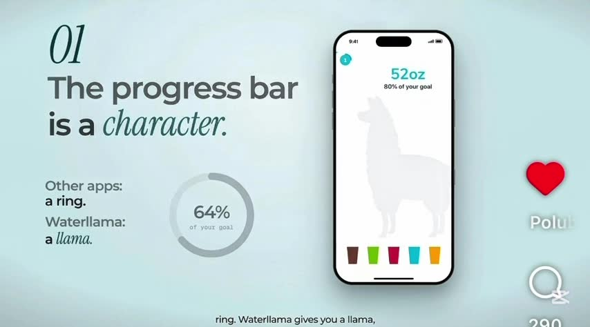
*0:46: zamiast pierścienia (64%) wypełnia się lama.* **Wniosek:** Pauseo ma już pasek 2 minut i koło oddechu. Nie potrzebuje postaci, tylko wypełniania z wyraźnym końcem.

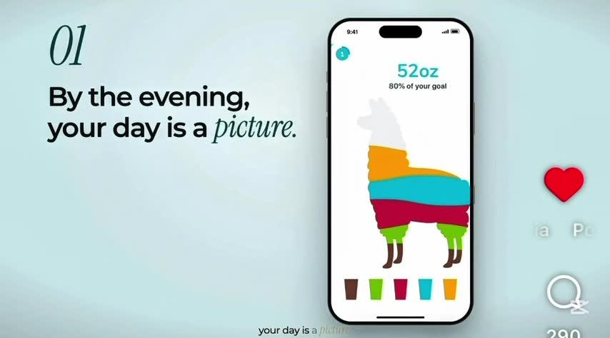
*0:50: po każdym napoju lama dostaje kolejny kolor, więc wieczorem „dzień jest obrazkiem”.* **Wniosek:** widoczny ślad wykonanej pracy. U nas odpowiednik już jest: „Przetrwane cravingi do tej pory: N”, które nigdy się nie zeruje.

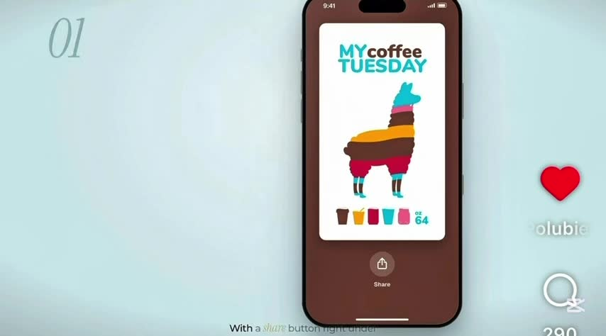
*0:52: karta „My coffee Tuesday” z przyciskiem Share pod spodem.* **Wniosek:** karta niesie treść i markę, ale nie dane osobowe. W Pauseo mogłaby to być karta wsparcia, nigdy wynik użytkownika.

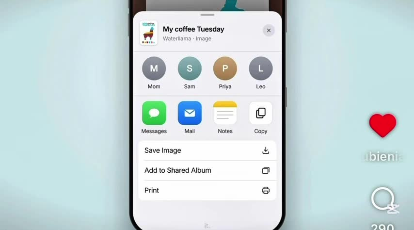
*0:53: zwykły systemowy arkusz udostępniania.* **Wniosek:** to ten sam mechanizm, który daje `ShareLink` w SwiftUI: bez sieci, bez SDK, bez zmiany etykiety prywatności [DO WERYFIKACJI w ASC].

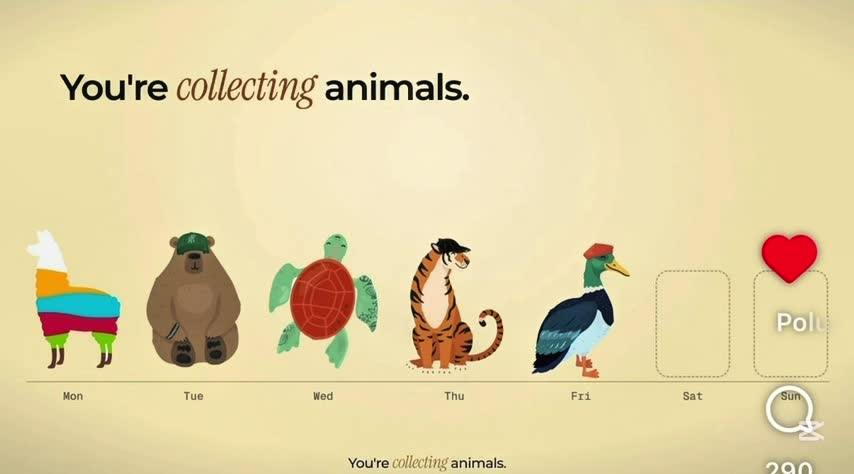
*1:01: „Zbierasz zwierzęta”, nowe na każdy dzień tygodnia.* **Wniosek:** ⛔ kolekcja nagradza częste używanie. W tej kategorii sukces to mniej cravingów (brief 7.1), więc nagroda za logowanie jest odwrócona.

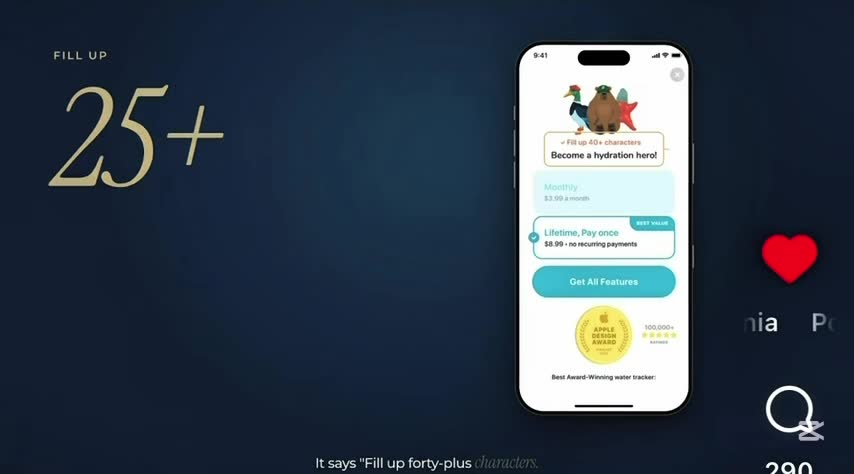
*1:05: paywall „Fill up 25+ characters”, droższy plan lifetime zaznaczony domyślnie.* **Wniosek:** ⛔ ADR-015 (pomoc w cravingu jest bezpłatna), a domyślnie zaznaczona droższa opcja łamie „never manipulative”.

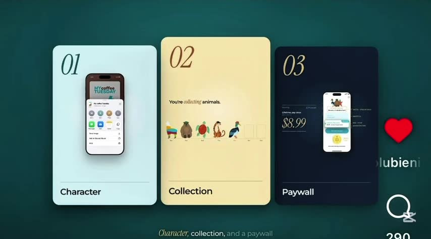
*1:13: ramka „Character, Collection, Paywall”.* **Wniosek:** ✅ sama ramka jest dobra. Pauseo ma własne trzy decyzje z ADR-017: moment, slip to dane, bez konta.

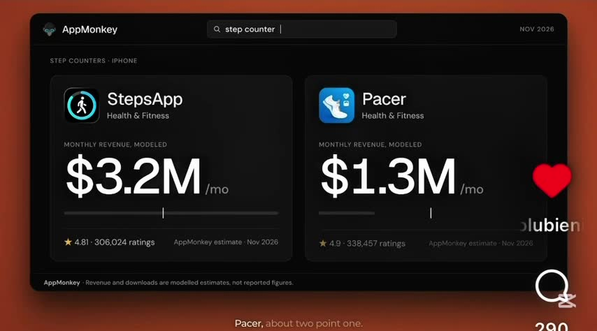
*2:09: AppMonkey: StepsApp 3,2 mln USD/mies., Pacer 1,3 mln USD/mies. (modelowane).* **Wniosek:** ✅ metoda: sprawdź, czego nie ma żadna duża apka w kategorii.

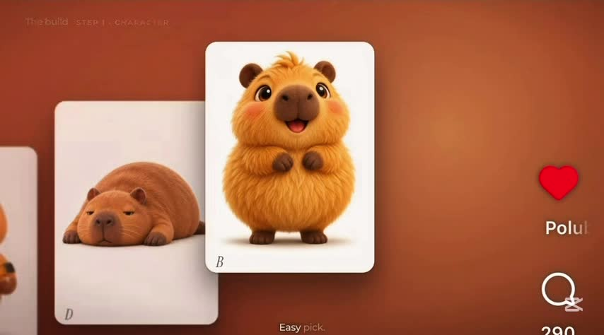
*2:33: kapibara wybrana spośród czterech wariantów.* **Wniosek:** ⛔ maskotka nie pasuje do tonu Pauseo: „adult, never childish” (`CLAUDE.md`).

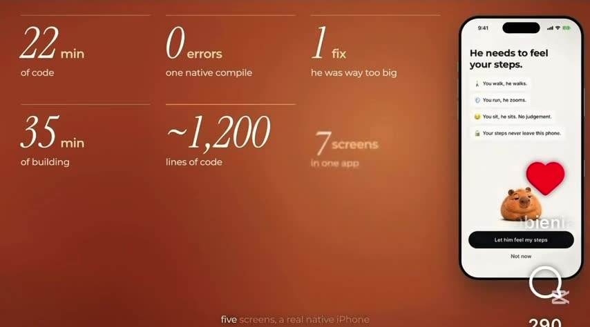
*3:21: 22 min kodu, 35 min całości, ok. 1 200 linii.* **Wniosek:** potwierdza, że mały zakres bez backendu to kilka godzin pracy, nie tygodnie. Czas wolimy wydać na QA i betę niż na dodatki.

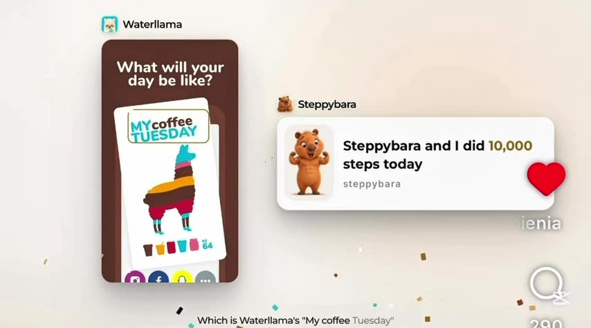
*3:37: karta „Steppybara and I did 10,000 steps today” obok „My coffee Tuesday”.* **Wniosek:** „każde udostępnienie to darmowa reklama”. U nas dopuszczalne tylko dla karty wsparcia (sekcja 7.3, wiersz 3).

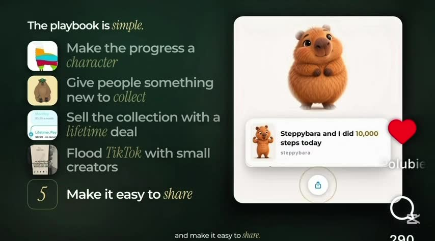
*4:26: playbook: postęp jako postać, coś nowego do zebrania, kolekcja sprzedawana jako lifetime, mali twórcy na TikToku, łatwe udostępnianie.* **Wniosek:** z pięciu punktów Pauseo bierze tylko ostatni (w wersji bez danych użytkownika) i częściowo czwarty.

### 7.3 Co można wykorzystać w Pauseo

Legenda: ✅ bierzemy, 🧪 adaptujemy lub testujemy, ⛔ nie bierzemy.

| # | Pomysł z filmu | Werdykt | Jak w Pauseo | Kanon |
|---|---|---|---|---|
| 1 | Postęp jako coś, co „żyje” | 🧪 bez postaci | W pętli 2-minutowej już jest pasek i koło oddechu (`BreathingStep`). Zamiast zwierzaka: jeden spójny element graficzny, który wypełnia się w czasie sesji i wyraźnie się domyka. | `CLAUDE.md` (ton), ADR-004 (żadnego „towarzysza”, ryzyko zależności emocjonalnej) |
| 2 | „Rusza się tylko wtedy, gdy Ty” | ✅ zasada projektowa | Nic w UI nie animuje się samo dla ozdoby. Animacja i haptyka pojawiają się tylko w odpowiedzi na działanie użytkownika (oddech, ukończenie). Reduce Motion zawsze respektowany. | low cognitive load |
| 3 | Karta do udostępnienia | 🧪 v0.2, po ADR | Przycisk „Podeślij komuś” na karcie wsparcia: tekst karty + źródło (WHO/NHS/NCI) + link do App Store przez systemowy `ShareLink`. Nie wysyłamy licznika, wyniku ani nic, co zdradza, że nadawca sam rzuca. | brief 6.3 („Wyślij komuś, kto rzuca”), Product_MVP „deferred” pkt 14 (public sharing) → wymaga zgody, ADR-014 (bez sieci) |
| 4 | Nowe zwierzę każdego dnia, kolekcja | ⛔ | Nagroda za zbieranie zachęca do częstszego logowania. Różnorodność już jest: 15 kart tasowanych w sesji, a druga runda preferuje nieużyte. | ADR-007, Product_MVP „deferred” pkt 13 (badge economy), brief 7.1 |
| 5 | „Po 10 dniach z rzędu robi się ripped”, postać szczuplejsza z dnia na dzień | ⛔ | To seria dni plus nagroda za wygląd ciała. Po slipie seria się kończy, a postać „tyje”. Dokładnie to, czego Pauseo unika. | ADR-007, „no shame” |
| 6 | Paywall sprzedający kolekcję, lifetime domyślnie zaznaczony | ⛔ | Brak płatności w v0.1. Jeśli kiedyś płatne funkcje, to nie gate'ujemy pomocy w cravingu ani slipie, i bez domyślnego zaznaczania droższej opcji. | ADR-015, „never manipulative” |
| 7 | Konfetti i „flex” po celu | 🧪 wersja dorosła | Po „Nie zapaliłem/am” lub „Odłożyłem/am”: jedna lekka haptyka sukcesu i spokojne domknięcie, bez konfetti. Po „Zapaliłem/am” i po wyjściu z pętli nic się nie zmienia. | `CLAUDE.md` (ton), ADR-007 |
| 8 | Rama „trzy decyzje” | ✅ | Trzy własne z ADR-017: moment, slip to dane, bez konta. Użyć jako screenshotów #1–#3 w App Store i trzech kafli na pauseo.app. | ADR-017 |
| 9 | Szukanie luki w kategorii (AppMonkey) | ✅ metoda | Hipoteza: duże apki do rzucania stawiają na liczniki dni, serie i „zaoszczędzone pieniądze”, a luką jest moment zamiast licznika (nasz ADR-017) [DO WERYFIKACJI]. Wykonać „Open verification” z ADR-017: ekrany onboardingu, liczba ocen i etykiety prywatności Smoke Free, QuitNow, Kwit. | ADR-017 „Open verification” |
| 10 | Znana rzecz jako hook (kapibara) | ⛔ maskotka, ✅ zasada | „Znaną rzeczą” w Pauseo jest sam moment ochoty: „Masz ochotę zapalić? Przeczekaj ze mną 2 minuty.” Hook to sytuacja widza, nie postać. | ADR-018 |
| 11 | Mali twórcy na TikToku i listy „best apps” | 🧪 | Lista 10–20 małych twórców PL (zdrowie, wellbeing, produktywność), jedna wiadomość z linkiem do bety i prośbą o opinię, bez skryptu „pobierz, bo apka zmieni Ci życie”. Współpraca płatna lub za produkt wymaga oznaczenia [DO WERYFIKACJI: wytyczne UOKiK, zasady TikTok i Meta dla treści o nikotynie]. | brief 6.1 (P1/P2), brief 6.4 (zero paid), ADR-018 |
| 12 | Skrypt UGC „Download X, glow up, energy hook” | ⛔ | Obiecuje zmianę i zbliża się do zakazanych claimów. W Pauseo hook = prawdziwa sytuacja i demo ekranu. | claims policy (`Privacy_Safety.md`) |

### 7.4 Jak zachęcić ludzi do korzystania (zgodnie z kanonem)

Pauseo nie „przyciąga” serią ani kolekcją. Zachęta to **mniej tarcia w momencie cravingu** i **zaufanie do prywatności**. Trzy poziomy, od najtańszego:

| Kiedy | Co | Koszt | Zgoda |
|---|---|---|---|
| **Przed review (do 15.12), bez kodu** | 1. Screenshoty #1–#3 w App Store = trzy decyzje (Home z jednym przyciskiem, 2-minutowa sekwencja, slip bez wstydu), #4 = prywatność. 2. Na pauseo.app trzy kafle z ADR-017 i 15–30 s demo pętli. 3. Hook wideo foundera: „Masz ochotę zapalić? Przeczekaj ze mną 2 minuty.”, z odliczaniem na ekranie (ADR-018). 4. Lista 10 małych twórców PL i wiadomość z linkiem do bety. 5. Słownik użytkownika z rozmów w becie (czy „craving”, czy „głód”). | kilka godzin | nie wymaga kodu |
| **v1.0.1 (po review), mały kod** | Miękkie domknięcie sukcesu (sekcja 7.5): jedna haptyka plus spokojne domknięcie po „Nie zapaliłem/am” i „Odłożyłem/am”. | ok. 1 godziny + QA | tak, pozycja w Backlogu |
| **v0.2, wymaga ADR** | 1. „Podeślij komuś” (`ShareLink`, tylko karta wsparcia). 2. Widżet lub skrót „Mam craving” (brief 7.2: priorytet wysoki). 3. Lokalne przypomnienia w porach, które użytkownik sam wskaże (ADR-008). 4. Dobrowolne podsumowanie do udostępnienia (ADR-014 C). | dni | tak, ADR dla pkt 1 (public sharing) |

### 7.5 Jak zrealizować jako MVP: miękkie domknięcie sukcesu

Format wymagany w `CLAUDE.md`. To jedyna zmiana w kodzie, którą z filmu da się obronić przed premierą. Nie jest zatwierdzona.

```text
CURRENT STATE
CompletionStep (Pauseo/CravingFlow/CravingFlowView.swift) pokazuje „To wystarczy na teraz.”,
licznik „Przetrwane cravingi do tej pory: N” (tylko po didNotSmoke/postponed) i raz na instalację
prosi o ocenę. W kodzie nie ma haptyki, ShareLink, widżetów ani AppIntents (grep 2026-11-25).

CONTRACT DRIFT
Domknięcie: brak (bez nowych danych, bez nowych tekstów, bez nowych ekranów).
„Podeślij komuś”: tak. Product_MVP „deferred” pkt 14 (public sharing). Najpierw ADR, potem kod.

TARGET STATE
Po didNotSmoke lub postponed: jedna haptyka sukcesu w momencie pojawienia się ekranu, a linia
z licznikiem pojawia się z krótkim (<0,4 s) wygaszeniem. Reduce Motion: bez animacji.
Po „Zapaliłem/am” i po „Kończę na teraz” bez outcome: bez zmian.

SMALLEST SAFE CHANGE
`.sensoryFeedback(.success, trigger: survivedCount)` na CompletionStep (iOS 17, a deployment
target projektu to 17.0) oraz `@Environment(\.accessibilityReduceMotion)` dla animacji licznika.

FILES TO CHANGE
Pauseo/CravingFlow/CravingFlowView.swift (CompletionStep), docs/Current_State.md,
docs/QA_Checklist_v0.1.md (nowy punkt), docs/Backlog_v0.1.md (pozycja).

ACCEPTANCE CRITERIA
1. Haptyka tylko po didNotSmoke i postponed. Nigdy po „Zapaliłem/am” ani po wyjściu bez outcome.
2. Z Reduce Motion nie ma animacji, tekst i licznik pokazują się od razu.
3. Brak nowych pól w EventStore, brak nowych tekstów w Localizable.xcstrings, brak sieci.
4. Prośba o ocenę działa jak dotąd (po 1,5 s, raz na instalację) i nie nakłada się na haptykę.

TEST PLAN
iPhone, PL i EN, cztery ścieżki: didNotSmoke, postponed, smoked, wyjście bez outcome.
Reduce Motion włączone i wyłączone. Tryb cichy i Low Power. Sprawdzić, że nic nie zmienia się po slipie.

RISKS / DEFERRED
Efektu nie zmierzymy (ADR-014), ocena jakościowa w becie. Ryzyko tonu: żadnego „Gratulacje!”,
żadnych fajerwerków. Odroczone: „Podeślij komuś” (ADR), widżet i skrót „Mam craving” (v0.2).
```

**Szkic „Podeślij komuś” (v0.2, tylko do decyzji):** przycisk tekstowy, nie główna akcja, na ekranie zakończenia po didNotSmoke lub w „Prywatność i dane”, **nie** wewnątrz pętli (żeby nie dodawać decyzji w szczycie cravingu). Treść: tekst jednej karty wsparcia + źródło + link do App Store. Zero danych użytkownika, zero sieci, zero nowych pól. Przed wdrożeniem: ADR i sprawdzenie, czy udostępnianie nie zmienia etykiety prywatności w ASC [DO WERYFIKACJI].

### 7.6 Decyzje do podjęcia

1. Czy wpisać „miękkie domknięcie sukcesu” do Backlogu na v1.0.1?
2. Czy „Podeślij komuś” ma być w v0.2 i gdzie w UI (ekran zakończenia czy Prywatność i dane)?
3. Czy zaczynamy listę 10 małych twórców PL przed premierą (ręcznie, zgodnie z ADR-018 i briefem 6.1)?

### 7.7 Transkrypcja filmu (4:55)

Transkrypcja automatyczna (Whisper small), poprawiona według napisów i ekranów w filmie: nazwy „Waterllama”, „Steppybara”, „Higgsfield”, „AppMonkey”, „Buildercult”, liczba Pacera według ekranu. Początek filmu urwany („… you take.”). Fragmenty niewyraźne zaznaczono w nawiasach kwadratowych.

**Oryginał (EN)**

- **0:00** […] Every sip of water you take fills up this llama, and it makes 3.7 million dollars a year. So I stole the idea for steps. Every step you take, this chonky capybara runs with you.
- **0:12** Here's why the llama makes millions, how I built mine with Claude Opus 5.5, and how you'd get it in front of people.
- **0:19** The app is Waterllama. About $310,000 a month and still climbing. More than 165,000 ratings and 4.87 stars.
- **0:28** Now here's the weird part. There are 146 water apps on the iPhone, and the typical one makes about $100 a month. Same feature: remind, log, repeat. So why does this one make thousands of times more? Three design decisions.
- **0:40** One. The progress bar is a character. Other apps give you a ring. Waterllama gives you a llama, and every drink fills him in its own color. So by the evening, your day is a picture: my coffee Tuesday, with a share button right under it.
- **0:53** Two. There's a new animal to fill every day, and the challenges are puns. [„T-Rex”, „Sober Bear”: niewyraźne.] You're not logging water anymore. You're collecting animals.
- **1:02** Three. The paywall doesn't sell reminders. It says: fill up 40-plus characters, become a hydration hero. And right next to monthly, a lifetime deal, $8.99, already picked. Character. Collection. And a paywall that sells more characters.
- **1:15** So I took those three decisions and put them on steps.
- **1:18** But why a capybara? You've seen him: the chonky guy who just pulls up, the one chilling while birds sit on his head, the one in a hot spring with an orange on his head. Capybara videos have over 100 million views on TikTok. People already love him before they ever open the app.
- **1:33** So that's my character: a chonky capybara for steps. Steppybara. In the morning he's a chonky little loaf. Start walking and he walks. Run and he runs. And the moment you stop running, he does this: he checks his belly. Every day he gets a little leaner, and if you keep it up 10 days in a row, he gets ripped.
- **1:52** So why steps and not water? I didn't guess. I asked AppMonkey right inside Claude. Think about it: you drink water maybe eight times a day, and you have to remember to log it. You walk all day without thinking, and your phone already counts every step, so the character can move by itself.
- **2:04** And that's a much bigger market. A steps app makes about $3.2 million a month. Pacer, about $1.3 million [w mowie: „2.1”]. And not one of the big step trackers has a character. The biggest walking pet app has 263 ratings. Same play as Waterllama, 10 times the market.
- **2:18** So I built it all inside Claude Opus 5.5, and you can copy every step.
- **2:24** Step one, the character. I asked Higgsfield for four looks: a loaf with an orange on his head, a vinyl toy, a lazy potato, and this fluffy baby. Easy pick. Then his turnaround, his expressions, and how he looks from chonky to lean, so he's the same character in every shot.
- **2:39** Step two, the animations. I tested two video models on the same walk. Kling kept his background the exact ivory of the app, at half the price. So Kling did the rest. Nine loops, and I used every single one as it came out. Every loop starts and ends on the same frame, so he goes from sit to walk to run without a jump.
- **2:57** Step three, the build. Claude Opus 5.5 with one rule: he only moves when you do. It counts your steps every few seconds. Slow means walk, fast means run, and the second a run ends, he flexes.
- **3:11** About 22 minutes of code, one native compile with zero errors and one fix: he was way too big on the first launch. About 35 minutes of building, around 1,200 lines, five screens, a real native iPhone app. No backend, no API keys, and about 214 Higgsfield credits for all of his animations.
- **3:29** And when you hit 10,000: confetti, the flex, and a card that says „Steppybara and I did 10,000 steps today”, which is Waterllama's „My coffee Tuesday” card for steps. Every share is a free ad. And I gave him a dance for when music's playing.
- **3:42** But an app is only half of it. The other half is getting found. So I dug into everything Waterllama does to get users. Their own TikTok has about 1,600 followers. The whole hashtag is about 1.2 million views. For an app making millions, that's tiny.
- **3:57** Then there's this: tiny accounts with almost no followers, all opening the same way: „Download Waterllama”, then a glow-up or an energy hook. „The llama gets sad if I don't finish.” It looks like a UGC program, but the real reach comes from creators' best-apps lists. One of them: 780,000 views. And even competitors use its name as their hook.
- **4:19** So the playbook is simple. Make the progress a character. Give people something new to collect. Sell the collection with a lifetime deal. Flood TikTok with small creators. And make it easy to share. All of that you can do in Buildercult AI from day one.
- **4:29** I added Steppybara as my app. It made UGC reaction videos that all end on Steppybara running, carousels with him on every slide, and the epic-look promo, ready to post. And if you'd rather skip the prompting and fixing, Buildercult builds the app too: pick a look and it designs the character and the app around it. Want everything? Comment „Steppy” and I'll send you the full build doc, every prompt and every step, plus the links.

**Tłumaczenie (PL)**

- **0:00** […] Każdy łyk wody, który wypijasz, wypełnia tę lamę, a ona zarabia 3,7 mln dolarów rocznie. Więc ukradłem ten pomysł na kroki. Z każdym krokiem ta pękata kapibara biegnie razem z tobą.
- **0:12** Oto dlaczego lama zarabia miliony, jak zbudowałem swoją w Claude Opus 5.5 i jak ją pokazać ludziom.
- **0:19** Apka to Waterllama. Około 310 tys. dolarów miesięcznie i wciąż rośnie. Ponad 165 tys. ocen i 4,87 gwiazdki.
- **0:28** Teraz dziwna część. Na iPhone'a jest 146 apek do wody, a typowa zarabia ok. 100 dolarów miesięcznie. Ta sama funkcja: przypomnij, zapisz, powtórz. Dlaczego ta zarabia tysiące razy więcej? Trzy decyzje projektowe.
- **0:40** Pierwsza. Pasek postępu jest postacią. Inne apki dają pierścień. Waterllama daje lamę, a każdy napój wypełnia ją swoim kolorem. Wieczorem twój dzień jest obrazkiem: „my coffee Tuesday”, a pod nim przycisk udostępniania.
- **0:53** Druga. Każdego dnia jest nowe zwierzę do wypełnienia, a wyzwania to kalambury. [„T-Rex”, „Sober Bear”: niewyraźne.] Nie zapisujesz już wody. Zbierasz zwierzęta.
- **1:02** Trzecia. Paywall nie sprzedaje przypomnień. Mówi: odblokuj ponad 40 postaci, zostań bohaterem nawodnienia. Obok planu miesięcznego jest opcja lifetime za 8,99 dolara, już zaznaczona. Postać. Kolekcja. I paywall, który sprzedaje więcej postaci.
- **1:15** Więc wziąłem te trzy decyzje i przeniosłem na kroki.
- **1:18** Dlaczego kapibara? Znasz ją: pękaty gość, który po prostu się pojawia, ten, który wypoczywa, gdy ptaki siedzą mu na głowie, ten w gorącym źródle z pomarańczą na głowie. Filmy z kapibarami mają ponad 100 mln wyświetleń na TikToku. Ludzie ją kochają, zanim w ogóle otworzą apkę.
- **1:33** To moja postać: pękata kapibara do kroków. Steppybara. Rano jest małym pękatym bochenkiem. Zacznij iść, a pójdzie. Biegnij, a pobiegnie. A gdy przestaniesz biec, robi to: sprawdza brzuch. Z dnia na dzień jest trochę szczuplejsza, a jeśli utrzymasz to 10 dni z rzędu, jest wyrzeźbiona.
- **1:52** Dlaczego kroki, a nie woda? Nie zgadywałem. Zapytałem AppMonkey wprost w Claude. Pomyśl: wodę pijesz może osiem razy dziennie i musisz pamiętać, żeby ją zapisać. Chodzisz cały dzień bez myślenia, a telefon już liczy każdy krok, więc postać może ruszać się sama.
- **2:04** To dużo większy rynek. Apka do kroków zarabia ok. 3,2 mln dolarów miesięcznie. Pacer ok. 1,3 mln [w mowie: „2.1”]. I żaden z dużych krokomierzy nie ma postaci. Największa apka z chodzącym zwierzakiem ma 263 oceny. Ten sam ruch co Waterllama, 10 razy większy rynek.
- **2:18** Więc zbudowałem to wszystko w Claude Opus 5.5 i możesz skopiować każdy krok.
- **2:24** Krok pierwszy, postać. Poprosiłem Higgsfield o cztery wyglądy: bochenek z pomarańczą na głowie, winylową zabawkę, leniwego ziemniaka i tego puchatego bobasa. Łatwy wybór. Potem jego obrót, miny i to, jak wygląda od pękatego do szczupłego, żeby w każdym ujęciu była tą samą postacią.
- **2:39** Krok drugi, animacje. Przetestowałem dwa modele wideo na tym samym chodzie. Kling zachował tło dokładnie w kolorze kości słoniowej z apki, za połowę ceny. Więc resztę zrobił Kling. Dziewięć pętli, wszystkie użyte tak, jak wyszły. Każda pętla zaczyna się i kończy na tej samej klatce, więc przechodzi od siedzenia do chodu i biegu bez skoku.
- **2:57** Krok trzeci, budowa. Claude Opus 5.5 z jedną zasadą: rusza się tylko wtedy, gdy ty. Liczy kroki co kilka sekund. Wolno znaczy chód, szybko znaczy bieg, a gdy bieg się kończy, napina mięśnie.
- **3:11** Ok. 22 minut kodu, jedna natywna kompilacja z zerem błędów i jedną poprawką: na pierwszym starcie był o wiele za duży. Ok. 35 minut budowy, około 1 200 linii, pięć ekranów, prawdziwa natywna apka na iPhone'a. Bez backendu, bez kluczy API i ok. 214 kredytów Higgsfield na wszystkie animacje.
- **3:29** A gdy osiągniesz 10 000: konfetti, napięcie mięśni i karta „Steppybara and I did 10,000 steps today”, czyli odpowiednik karty „My coffee Tuesday” z Waterllama, ale dla kroków. Każde udostępnienie to darmowa reklama. Dodałem mu też taniec, gdy gra muzyka.
- **3:42** Ale apka to tylko połowa. Druga połowa to bycie znalezionym. Przejrzałem więc wszystko, co Waterllama robi, żeby zdobywać użytkowników. Ich własny TikTok ma ok. 1 600 obserwujących. Cały hashtag ma ok. 1,2 mln wyświetleń. Dla apki, która zarabia miliony, to bardzo mało.
- **3:57** Są też malutkie konta prawie bez obserwujących, które otwierają tak samo: „Pobierz Waterllama”, a potem hook „glow up” albo „energia”. „Lama robi się smutna, jeśli nie skończę.” To wygląda jak program UGC, ale prawdziwy zasięg dają listy „najlepszych apek” od twórców. Jedna ma 780 tys. wyświetleń. Nawet konkurenci używają jej nazwy w swoich hookach.
- **4:19** Więc playbook jest prosty. Zrób z postępu postać. Daj ludziom coś nowego do zbierania. Sprzedaj kolekcję planem lifetime. Zalej TikToka małymi twórcami. I ułatw udostępnianie. Wszystko to zrobisz w Buildercult AI od pierwszego dnia.
- **4:29** Dodałem Steppybarę jako swoją apkę. Zrobił filmy UGC z reakcjami, które kończą się biegnącą Steppybarą, karuzele z nią na każdym slajdzie i epicki film promocyjny, gotowy do publikacji. A jeśli wolisz pominąć promptowanie i poprawki, Buildercult buduje też apkę: wybierasz wygląd, a on projektuje postać i apkę wokół niej. Chcesz całość? Napisz w komentarzu „Steppy”, a wyślę ci pełny dokument z budową: każdy prompt, każdy krok i linki.
